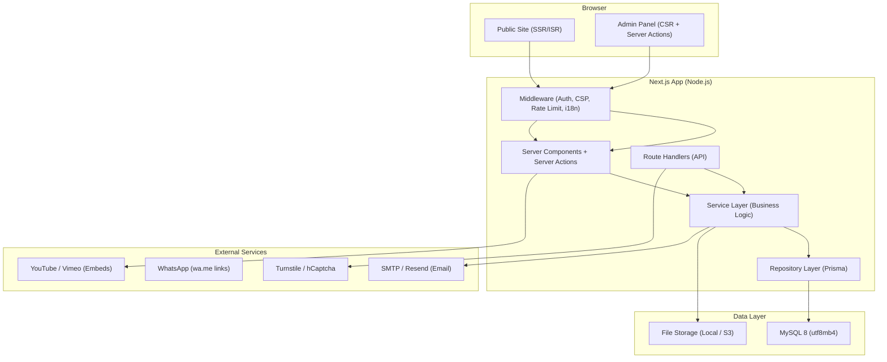
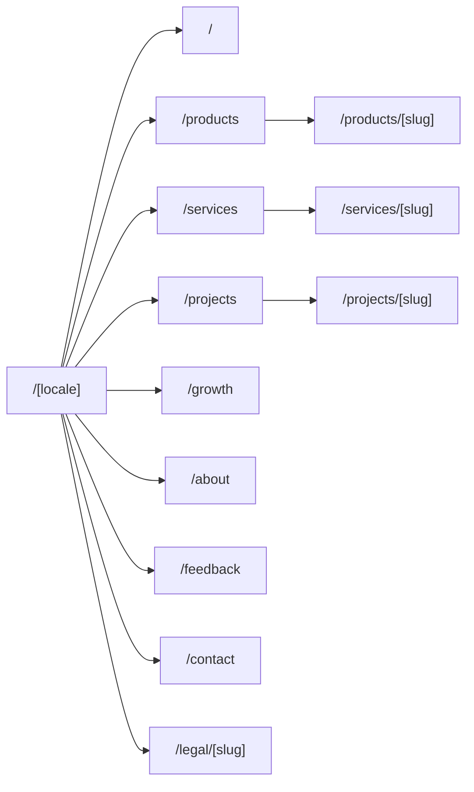
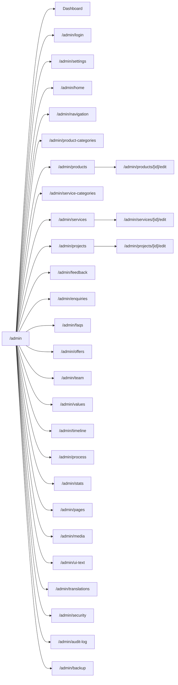
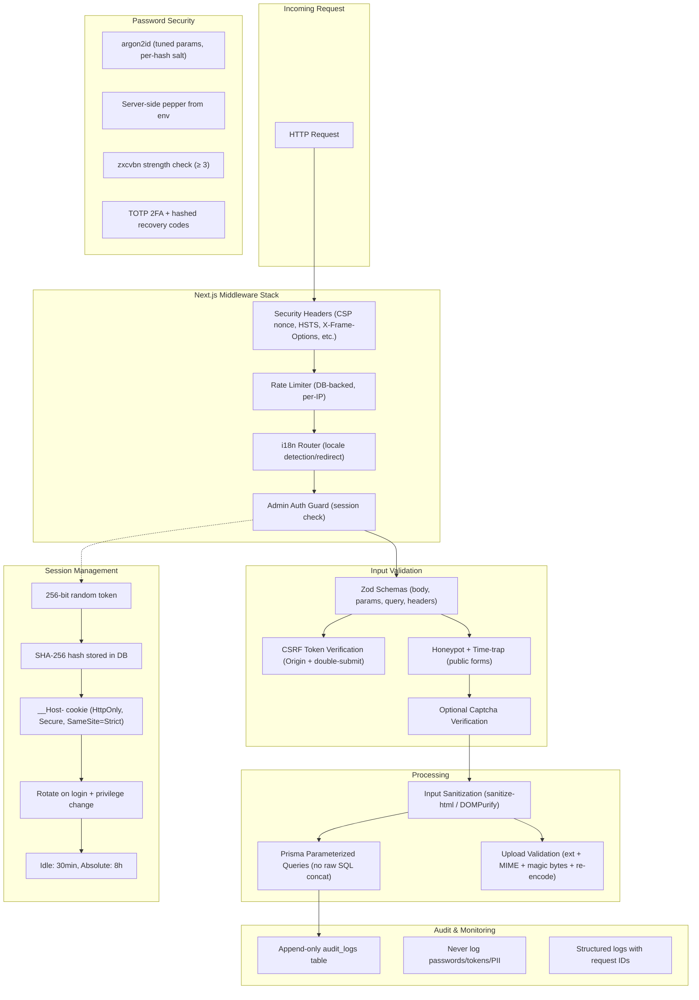
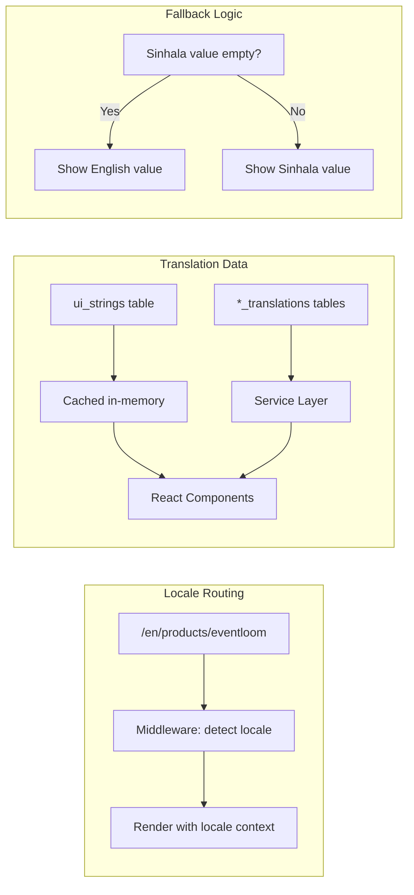
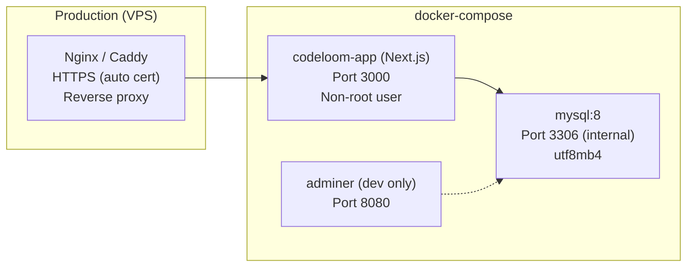

# Code Loom — Architecture Document

> Generated: 2026-11-16 | Phase 0 — Analysis & Plan

---

## 1. High-Level Architecture



---

## 2. Route Map

### 2.1 Public Routes (locale-prefixed: `/en/...` and `/si/...`)



### 2.2 Admin Routes (no locale prefix)



### 2.3 API Routes

```
POST /api/enquiry            — Submit enquiry form
POST /api/feedback           — Submit public feedback
GET  /api/media/[id]         — Serve uploaded media (controlled)
POST /api/admin/upload       — Admin media upload
POST /api/admin/export       — Content export (JSON)
GET  /api/sitemap.xml        — Dynamic sitemap
GET  /api/robots.txt         — Dynamic robots.txt
GET  /.well-known/security.txt
```

---

## 3. Entity Relationship Diagram

```mermaid
erDiagram
    admin_users ||--o{ admin_sessions : "has"
    admin_users ||--o{ audit_logs : "creates"

    locales ||--o{ site_settings_translations : "has"
    locales ||--o{ ui_strings : "has"
    locales ||--o{ products_translations : "has"
    locales ||--o{ services_translations : "has"
    locales ||--o{ projects_translations : "has"

    site_settings {
        string key PK
        json value
        string group
    }

    site_settings_translations {
        int id PK
        string setting_key FK
        string locale FK
        text value
    }

    ui_strings {
        int id PK
        string key UK
        string locale FK
        text value
        string group
        string description
    }

    social_links {
        int id PK
        string platform
        string url
        int sort_order
        boolean is_active
    }

    nav_items {
        int id PK
        string label
        string href
        int parent_id FK
        int sort_order
        boolean is_visible
        string location
    }

    home_sections {
        int id PK
        string key UK
        json config_json
        int sort_order
        boolean is_visible
    }

    media {
        int id PK
        string type
        string storage_path
        string public_url
        string mime
        int size
        string alt_text
        string checksum
    }

    product_categories ||--o{ products : "contains"
    product_categories {
        int id PK
        string slug UK
        int sort_order
    }

    products ||--o{ product_features : "has"
    products ||--o{ product_media : "has"
    products ||--o{ product_links : "has"
    products ||--o{ products_translations : "has"
    products {
        int id PK
        int category_id FK
        string slug UK
        int logo_id FK
        int cover_id FK
        string video_type
        string video_url
        string status
        boolean is_featured
        int sort_order
        boolean is_published
    }

    products_translations {
        int id PK
        int product_id FK
        string locale FK
        string name
        string tagline
        text short_description
        text long_description
        text target_audience
        string seo_title
        string seo_description
    }

    product_features {
        int id PK
        int product_id FK
        string icon
        int sort_order
    }

    product_media {
        int id PK
        int product_id FK
        int media_id FK
        string caption
        int sort_order
    }

    product_links {
        int id PK
        int product_id FK
        string label
        string url
        string type
        boolean is_primary
        int sort_order
    }

    service_categories ||--o{ services : "contains"
    service_categories {
        int id PK
        string slug UK
        int sort_order
    }

    services ||--o{ services_translations : "has"
    services {
        int id PK
        int category_id FK
        string slug UK
        int image_id FK
        json features
        boolean is_featured
        int sort_order
        boolean is_published
    }

    services_translations {
        int id PK
        int service_id FK
        string locale FK
        string title
        text short_description
        text long_description
        string seo_title
        string seo_description
    }

    project_categories ||--o{ projects : "contains"
    project_categories {
        int id PK
        string slug UK
        int sort_order
    }

    projects ||--o{ project_links : "has"
    projects ||--o{ project_social_work : "has"
    projects ||--o{ project_media : "has"
    projects ||--o{ projects_translations : "has"
    projects {
        int id PK
        int category_id FK
        string slug UK
        string project_type
        boolean is_featured
        boolean is_published
    }

    projects_translations {
        int id PK
        int project_id FK
        string locale FK
        string title
        string client_name
        text summary
        text challenge
        text solution
        text result
        string seo_title
        string seo_description
    }

    project_social_work {
        int id PK
        int project_id FK
        string platform
        string handle
        string profile_url
        text summary
        int sort_order
    }

    feedback {
        int id PK
        string status
        string name
        string company
        string role
        string email_enc
        int rating
        text message
        int photo_media_id FK
        int related_project_id FK
        int related_product_id FK
        boolean consent_to_publish
        string source
        string submitted_ip_hash
        string locale
        boolean is_featured
        int display_order
    }

    enquiries {
        int id PK
        string name
        string email
        string phone
        string business_name
        string interest
        string budget_range
        text message
        string status
        string source_page
        string ip_hash
        string locale
        datetime deleted_at
    }

    enquiries ||--o{ enquiry_notes : "has"
    enquiry_notes {
        int id PK
        int enquiry_id FK
        int admin_id FK
        text note
    }

    faqs {
        int id PK
        string group
        int sort_order
        boolean is_published
    }

    offers {
        int id PK
        int image_id FK
        string badge
        datetime valid_from
        datetime valid_to
        boolean is_published
    }

    team_members {
        int id PK
        int photo_id FK
        int sort_order
        boolean is_visible
    }

    core_values {
        int id PK
        string icon
        int sort_order
    }

    timeline_events {
        int id PK
        string year
        int sort_order
    }

    process_steps {
        int id PK
        string icon
        json bullets
        int sort_order
    }

    stats {
        int id PK
        string value
        string suffix
        int sort_order
    }

    pages_content {
        int id PK
        string slug UK
        boolean is_published
    }

    locales {
        string code PK
        string name
        string native_name
        boolean is_default
        boolean is_enabled
        string direction
    }

    login_attempts {
        int id PK
        string key
        int count
        datetime window_start
    }
```



> [!NOTE]
> Translation tables (`*_translations`) follow a consistent pattern: `entity_id + locale` composite unique key, with all language-dependent text columns. Language-neutral columns (slugs, images, URLs, sort order, publish flags, status, ratings) stay on the main table.

---

## 4. Security Architecture



### 4.1 Key Security Controls (OWASP Top 10 mapping)

| OWASP Category | Controls |
|---|---|
| **A01 Broken Access Control** | Server-side auth on every route + action, deny-by-default, no IDOR (published-only public queries), CSRF protection, `rel="noopener noreferrer"`, `X-Frame-Options: DENY` |
| **A02 Cryptographic Failures** | HTTPS-only, HSTS, argon2id passwords, SHA-256 session tokens, encrypted TOTP secrets, hashed IPs, no secrets in client bundle |
| **A03 Injection** | Prisma parameterized queries, Zod validation on all inputs, strict sanitize-html allowlist, nonce-based CSP, no `unsafe-inline`/`unsafe-eval` |
| **A04 Insecure Design** | Threat model (STRIDE), rate limiting, anti-bot on forms, feedback moderation flow, upload re-encoding |
| **A05 Security Misconfiguration** | Env validation at boot (Zod), no verbose errors, `X-Powered-By` removed, source maps off in prod, directory listing disabled |
| **A06 Vulnerable Components** | Pinned lockfile, `npm audit` / `osv-scanner` in CI, Renovate config |
| **A07 Auth Failures** | Brute-force protection, account lockout, constant-time comparison, generic error messages, uniform timing, 2FA, session rotation |
| **A08 Data Integrity Failures** | Content versioning, audit log, signed preview tokens, no arbitrary deserialization |
| **A09 Logging & Monitoring** | Structured logging, audit trail, request IDs, no PII in logs |
| **A10 SSRF** | DNS resolution validation (block private/loopback/link-local/metadata IPs), redirect limits, timeout, no credentials |

### 4.2 Content Security Policy (Production)

```
default-src 'none';
script-src 'self' 'nonce-{random}' https://challenges.cloudflare.com;
style-src 'self' 'nonce-{random}';
img-src 'self' data: blob:;
font-src 'self';
connect-src 'self';
media-src 'self' blob:;
frame-src https://www.youtube-nocookie.com https://player.vimeo.com https://challenges.cloudflare.com;
base-uri 'self';
form-action 'self';
frame-ancestors 'none';
upgrade-insecure-requests;
```

---

## 5. Internationalisation Architecture



---

## 6. Technology Decisions

| Decision | Choice | Rationale |
|---|---|---|
| ORM | Prisma | Type-safe, migration management, MySQL support |
| Auth sessions | Opaque DB tokens | Simpler, revocable, no JWT complexity |
| Password hash | argon2id via `@node-rs/argon2` | Best-in-class, OWASP recommended |
| i18n | `next-intl` | Mature, App Router support, locale-prefixed routes |
| Rich text editor | TipTap | Extensible, React-native, output sanitizable |
| Image processing | sharp | Fast, Node-native, WebP/AVIF support |
| Animation | Framer Motion + GSAP + Lenis | Premium feel, scroll storytelling, smooth scroll |
| 3D | React Three Fiber + drei | Lightweight, lazy-loadable, React integration |
| Admin UI primitives | shadcn/ui (Radix) | Accessible, customizable, no generic look |
| Forms | React Hook Form + Zod | Performance, type-safe validation |
| Rate limiting | DB-backed | No Redis dependency for MVP |
| Storage | Local (interface for S3 later) | Simple start, pluggable |

---

## 7. Performance Strategy

| Technique | Where |
|---|---|
| SSR + ISR with on-demand revalidation | All public pages |
| `next/image` with AVIF/WebP | All images |
| `next/font` (self-hosted) | All fonts |
| Route-level code splitting | Automatic via App Router |
| Dynamic imports (`ssr: false`) | R3F 3D canvas, GSAP heavy plugins |
| Click-to-load video facade | Product/project videos |
| Font subsetting | Sinhala + Latin character sets |
| `Cache-Control` | Media, static assets |
| Skeleton loading states | All data-dependent sections |

---

## 8. Docker Architecture


